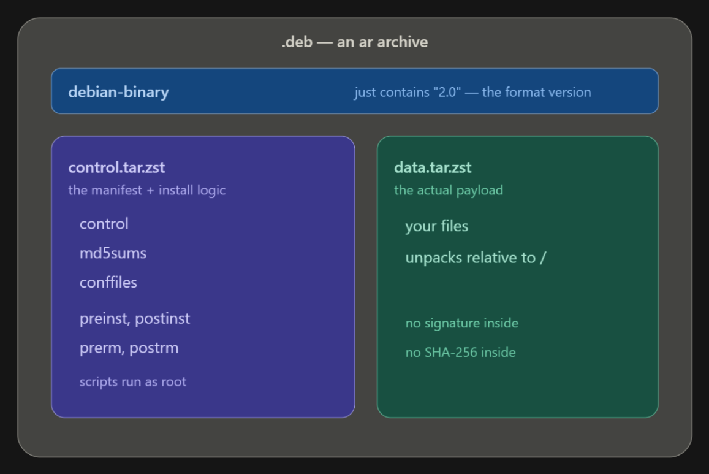

# Distro Packaging Notes

As I am learning Linux Engineering and also a working professional in security field, why not I keep my proof of my work and skills? It's time saving and helps other to assess my knowledge, work and accuracy also helps me to revise the topics faster. So here we go, this is the part 01: Distro Packaging. 

## 01. Introduction

If you install a package in linux, you have 2 programs doing 2 different things.

One is **dpkg** another is **apt**. We can say dpkg is the local installer which just takes a .deb file which is already downloaded and unpacks it. **apt** is the negotiator who knows how to download, check integrity and then rearrange them into right order.

**dpkg** sure install the .deb file already in the disk but;
* Cannot download
* Cannot check hashes
* Cannot resolve dependency issues

**apt** never install anything but it does something important for **dpkg** before installing, **apt** can:
* Knows repositories
* Download indexes
* Verifies signatures
* Figures the full set of packets needed and Download them
* Check their Hashes
* Rearrange them into right order

***apt** is a sophisticated front end negotiator which always deliver the actual installation file to **dpkg***

## 02. The .deb file

See the image that I created in Canva:


We know about .zip, .rar, .tar files but **.deb** file is an **ar** archive file. 
*ar archive file is an ancient UNIX archive format*

So, now give me the opportunity to describe 3 things from the image:

* **debian-binary** contains the version
* **control.tar.zst** is unpacked and you get:
    * **control** file contains (Strictly requires 5 and rests are optional):
        * Packages
        * Version
        * Architecture
        * Maintainer
        * Description
        * *Everything else is optional*
    * **md5sums file**
    * **maintainer scripts**: preinst, postinst, prerm, postrm
    *These scripts run as root btw*
* **data.tar.zst** is the file where actual payload stays

## 03. The dpkg database

Basically what is the database? Already we know the .deb file structure, so where does those data stays?
**.deb** file has it's own local database. Here is the list:
* /var/lib/dpkg/status
  every stanza or phrase explains one package, what is installed and in what state. If there is a confusion with a file then I go and look for the status before investigating furthure. 
* /var/lib/dpkg/info/packageName.*
  holds per-package files that got extracted, like:
    * .list: every path the package owns
    * .md5sums: 
    * .conffiles
    * maintainers scripts: 

Here I gave an example output for nmap in my ubuntu server

**/var/lib/dpkg/status**
```bash
ubuntu@UbuntuServer:/$ sudo cat /var/lib/dpkg/status
```
Output:
```bash
Package: nmap-common
Status: install ok installed
Priority: optional
Section: net
Installed-Size: 21470
Maintainer: Ubuntu Developers <ubuntu-devel-discuss@lists.ubuntu.com>
Architecture: all
Multi-Arch: foreign
Source: nmap
Version: 7.94+git20230807.3be01efb1+dfsg-3build2
Recommends: nmap
Description: Architecture independent files for nmap
Nmap is a utility for network exploration or security auditing. It
supports ping scanning (determine which hosts are up), many port
scanning techniques, version detection (determine service protocols
and application versions listening behind ports), and TCP/IP
fingerprinting (remote host OS or device identification). Nmap also
offers flexible target and port specification, decoy/stealth scanning,
sunRPC scanning, and more. Most Unix and Windows platforms are
supported in both GUI and commandline modes. Several popular handheld
devices are also supported, including the Sharp Zaurus and the iPAQ.
 .
 This package contains the nmap files shared by all architectures.
Homepage: https://nmap.org/
Original-Maintainer: Debian Security Tools <team+pkg-security@tracker.debian.org>
```
**/var/lib/dpkg/info/packageName.\***
```bash
ubuntu@UbuntuServer:/var/lib/dpkg$ ls -la /var/lib/dpkg/info/nmap-common.*
```
Output:
```bash
-rw-r--r-- 1 root root 34927 Oct 29 06:45 /var/lib/dpkg/info/nmap-common.list
-rw-r--r-- 1 root root 61469 Apr  1  2024 /var/lib/dpkg/info/nmap-common.md5sums
-rwxr-xr-x 1 root root   349 Apr  1  2024 /var/lib/dpkg/info/nmap-common.postinst
-rwxr-xr-x 1 root root   262 Apr  1  2024 /var/lib/dpkg/info/nmap-common.prerm
```

*Note: I want to explain few things here from security prespective: There is no signature and nothing is Sha-256 when the record is installed. All the authentication checks happen in apt layer or before the dpkg ever start with the file. Once package is unpacked, only per file record is an MD5 list to match against them. Let's go to attacker prespective, if I am an attacker and already in root, I can tamper with a binary and update the MD5 list to match and **dpkg --verify** will report everything as "OK". <span style="color:red">That's why, package-manager integrity checking is absolutely not a substitute for real file-integrity monitoring at all</span>*

## 04. dpkg vs apt

Yohooo, bingo, now we're going to see the actual thing. 

**dpkg** is the engine which works beyond just unpack/configure/remove. It owns four local mechanisms (and yes, you need to memorize them):
* conffiles: config-file protection
* diversions (dpkg-divert): Basically when a package tries to install to path A, we can silently divert them and put them to path B. 
* alternatives (update-alternatives): Just imagine this, we use which python to see which actual python we're using, using update-alternatives we can change the default directory from /usr/bin/python3 to another path. To install a new choice, the example given after this bullet points.
* database (itself)

```bashsudo update-alternatives --install /usr/bin/java java /path/to/new/java/bin/java 200
sudo update-alternatives --install /usr/bin/java java /newPathTo/java/bin/java 200
```

**apt** is the *libapt-pkg* with various front-ends like: **apt**, **apt-get**, **apt-cache**, **apt-mark**. unattendent-upgrades and PackageKit are also callers of the library or *libapt-pkg*. apt owns everything like: 
* reporsitory-related sources
* fetching
* verifying indexes
* version selection
* dependency solving
* downloading
* hash-checking
* operation ordering

Note: Here I also need to state that, I do automation work for my current(Nov, 2026) organization and for my automation I use **apt-get** and **apt-cache** and I never use apt. Here's why: <span style="color:red">apt is tuned for human and it explicitly warns that it's CLI output isn't stable across version. Below is the exact line:</span>

```bash
WARNING: apt does not have a stable CLI interface. Use with caution in scripts.
```
Here is the investigator's toolkit I use and the reason:
```bash
dpkg -L openssh-server      # every file openssh-server installed
dpkg -S /usr/sbin/sshd      # which package owns this path (also flags diversions)
dpkg -s openssh-server      # its stanza from the status db 
dpkg -l 'openssh*'          # states: ii=installed, rc=config-only, iU=unpacked, iF=half-configured
apt-cache policy nginx      # installed vs candidate version, origins, pin priorities
apt-cache rdepends nginx    # reverse deps — what breaks if I remove this
apt-get -s install nginx    # dry-run the solver, shows the plan, no root needed
apt-mark showauto           # packages pulled in as deps (what autoremove would reap)
```

*PLease run this and test them on your own, the outputs are huge so I am not pasting them here indefinitely*

**apt-cache policy** and **apt-get -s install** are the best option to memorize.
**apt-cache policy**: why a given version would be chosen
**apt-get -s install**: what would happen if I commit to install

## 05. The work of <span style="color:green">$apt install package</span>
This is the flow:
1. **Read config** from 
    * /etc/apt/apt.conf.d/
    * /etc/apt/sources.list.d/
    * /etc/apt/preferences.d/
2. **Load the cache** The already-verified repository indexes in:
    * /var/lib/apt/lists/ 
    * dpkg's status db.
3. **Solve:** Pick the candidate (highest pin priority, then highest version), pull in Depends and Recommends, respect Conflicts/Breaks.
4. **Fetch:** The download runs as the unprivileged _apt user <span style="color: red">(This is a deliberate privilege-drop, so a malicious server can't hit a root-level download bug)</span> into /var/cache/apt/archives/.
5. Verify. Each downloaded .deb's size and SHA-256 must match its entry in the signed index. This is the actual authenticity gate.
6. Run DPkg::Pre-Invoke hooks as root.
7. Hand off to dpkg --unpack / --configure in the computed order.
8. Run DPkg::Post-Invoke hooks as root.
9. Record which packages were auto-installed into /var/lib/apt/extended_states (so autoremove knows what to clean up later).


The verification in step 5 is the whole security story in one line: the package is trusted because its hash is listed in an index that was cryptographically signed. The .deb isn't signed — the index that vouches for it is.